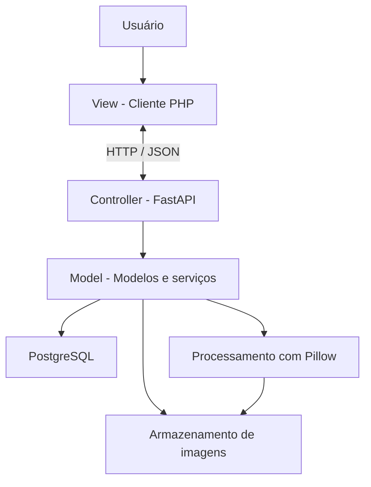

# ConverteAqui

Aplicação web para conversão, compressão e redimensionamento de imagens, com contas de usuário e histórico individual. O projeto atende ao tema **Construção e Avaliação de uma Arquitetura de Sistemas Integrada via Serviços REST**.

> **Estado atual:** estrutura inicial do projeto. A API FastAPI possui as rotas introdutórias `/` e `/api/v1/health`, e o cliente PHP apresenta uma página inicial. O PostgreSQL pode ser iniciado pelo Docker Compose. A integração entre API e banco, autenticação, upload persistente, processamento de imagens e histórico ainda serão implementados.

## 1. Funcionalidades previstas

- Cadastro e autenticação de usuários.
- Envio de imagens.
- Compressão para redução do tamanho dos arquivos.
- Conversão entre JPEG, PNG e WebP.
- Redimensionamento com preservação ou alteração das proporções.
- Histórico individual de imagens e conversões.
- Visualização de metadados e download dos resultados.

Os arquivos originais e convertidos serão armazenados no sistema de arquivos do servidor. O PostgreSQL armazenará os metadados, parâmetros, caminhos e relacionamentos entre os registros.

## 2. Arquitetura proposta

A aplicação será organizada em três camadas, utilizando o padrão arquitetural MVC (Model–View–Controller) como referência para a separação de responsabilidades.

1. **View (Apresentação):** cliente web desenvolvido em PHP, HTML, CSS e JavaScript, responsável pela interface e interação com o usuário. O PHP consome a API por HTTP e não acessa diretamente o PostgreSQL.
2. **Controller (Controle):** endpoints da API REST desenvolvida com FastAPI, responsáveis por receber requisições, validar parâmetros, controlar o fluxo das operações e encaminhar solicitações aos serviços correspondentes.
3. **Model (Modelo):** componentes responsáveis pela representação dos dados, acesso ao PostgreSQL e execução das regras de negócio. Inclui os serviços de processamento de imagens com Pillow.

A persistência será realizada no PostgreSQL, enquanto os arquivos originais e convertidos serão armazenados separadamente na pasta `storage/`.



## 3. Relação com o plano de execução

| Exigência | Aplicação no projeto |
|---|---|
| Arquitetura e padrões | Arquitetura em camadas e aplicação do padrão MVC |
| Sistema que exponha dados via REST | API FastAPI com recursos de usuários, imagens e conversões |
| XML ou JSON | JSON como formato principal de comunicação |
| Cliente web JSP ou PHP | Cliente PHP complementado por HTML, CSS e JavaScript |
| Métodos GET, POST, PUT e DELETE | Operações de consulta, criação, atualização e exclusão de recursos |
| Banco relacional | PostgreSQL para usuários, imagens e conversões |
| Testes HTTP | Postman e documentação interativa do FastAPI em `/docs` |

## 4. Estrutura do repositório

```text
image-converter/
├── backend/
│   ├── app/
│   │   ├── api/v1/endpoints/   # Rotas REST por recurso
│   │   ├── core/               # Configurações e segurança
│   │   ├── db/                 # Conexão e sessões do PostgreSQL
│   │   ├── models/             # Modelos das entidades
│   │   ├── schemas/            # Validação e representação dos dados
│   │   ├── services/           # Regras e processamento de imagens
│   │   └── main.py             # Criação da aplicação FastAPI
│   ├── alembic/versions/       # Migrações do banco
│   ├── tests/                  # Testes automatizados
│   └── requirements.txt        # Dependências Python
├── frontend/
│   ├── public/                 # Raiz pública do cliente PHP e assets
│   └── src/                    # Código PHP reutilizável
├── storage/
│   ├── originals/              # Imagens originais
│   └── converted/              # Arquivos convertidos
├── docs/                       # Documentação técnica
├── .env.example                # Modelo das variáveis locais
├── .gitignore                  # Arquivos ignorados pelo Git
├── docker-compose.yml          # PostgreSQL local
└── README.md                   # Visão geral e instruções
```

### Entidades previstas

- `users`: conta, e-mail único, hash da senha e data de criação.
- `images`: proprietário, nome, formato, dimensões, tamanho e caminho do original.
- `conversions`: imagem de origem, formato, qualidade e parâmetros, dimensões finais, caminho, tamanho e data.

Um usuário poderá possuir várias imagens, e cada imagem poderá possuir várias conversões. As operações deverão verificar a propriedade do recurso pelo usuário autenticado.

## 5. Tecnologias

| Parte | Tecnologia |
|---|---|
| Cliente web | PHP, HTML, CSS e JavaScript |
| API REST | Python e FastAPI |
| Servidor ASGI | Uvicorn |
| Banco de dados | PostgreSQL |
| ORM | SQLAlchemy |
| Migrações | Alembic |
| Processamento de imagens | Pillow |
| Ambiente local | Docker Compose |
| Testes HTTP | Postman e `/docs` |
| Versionamento | Git e GitHub |

## 6. Preparação do ambiente

### Pré-requisitos

Git, Docker com Compose, Python 3.12 (ou compatível com as dependências) e PHP com a extensão cURL habilitada. Postman é recomendado para os testes HTTP.

### 6.1. Clonar o repositório

```bash
git clone URL_DO_REPOSITORIO
cd image-converter
```

### 6.2. Criar `.env` local

Windows PowerShell:

```powershell
Copy-Item .env.example .env
```

Linux/macOS:

```bash
cp .env.example .env
```

Personalize as variáveis necessárias em `.env`. Esse arquivo já está protegido contra inclusão no Git por meio do `.gitignore` e não deve ser enviado ao GitHub.

### 6.3. Iniciar PostgreSQL

```bash
docker compose up -d db
docker compose ps
```

A porta padrão é `5432`. Se estiver ocupada, altere `POSTGRES_PORT` no `.env` e ajuste a porta correspondente na configuração de conexão do backend.

O volume `postgres_data` preserva os dados do banco entre reinicializações dos containers. Evite executar `docker compose down -v`, pois a opção `-v` remove os volumes e apaga os dados locais.

### 6.4. Criar ambiente Python

Na pasta `backend/`:

Windows PowerShell:

```powershell
py -3.12 -m venv .venv
.\.venv\Scripts\Activate.ps1
python -m pip install -r requirements.txt
```

Linux/macOS:

```bash
python3.12 -m venv .venv
source .venv/bin/activate
python -m pip install -r requirements.txt
```

### 6.5. Executar API

Ainda em `backend/`:

```bash
uvicorn app.main:app --reload --host 127.0.0.1 --port 8000
```

- `http://127.0.0.1:8000/` — informações básicas da API.
- `http://127.0.0.1:8000/api/v1/health` — disponibilidade do processo da API.
- `http://127.0.0.1:8000/docs` — documentação interativa.
- `http://127.0.0.1:8000/redoc` — documentação ReDoc.

**Nota:** atualmente, `/api/v1/health` confirma apenas que o processo da API está respondendo. A verificação da conexão com PostgreSQL será incluída quando a integração com o banco for implementada.

### 6.6. Executar cliente PHP

Na raiz do repositório, em outro terminal:

```bash
php -S 127.0.0.1:8080 -t frontend/public
```

Acesse `http://127.0.0.1:8080/`. A página inicial apresenta o ConverteAqui e seu estado de desenvolvimento. A integração com a API será implementada nas próximas etapas.

## 7. Colaboração com Git

1. Atualizar a branch `main` antes de iniciar uma tarefa.
2. Criar uma branch específica, como `feature/database-setup` ou `feature/api-health`.
3. Desenvolver e testar localmente.
4. Enviar a branch e abrir um Pull Request.
5. Solicitar a revisão de outro integrante antes de integrar as alterações à `main`.

O desenvolvimento deve ocorrer em branches separadas, evitando alterações diretamente na `main`. Não devem ser versionados o `.env`, ambientes virtuais, imagens enviadas pelos usuários ou dados locais do PostgreSQL.

## 8. Documentação complementar

- `docs/architecture.md`: arquitetura, camadas e comunicação entre componentes.
- `docs/database.md`: entidades e relacionamentos previstos.
- `docs/endpoints.md`: contrato e estado das rotas da API.
- `docs/risks.md`: riscos identificados e medidas de tratamento.